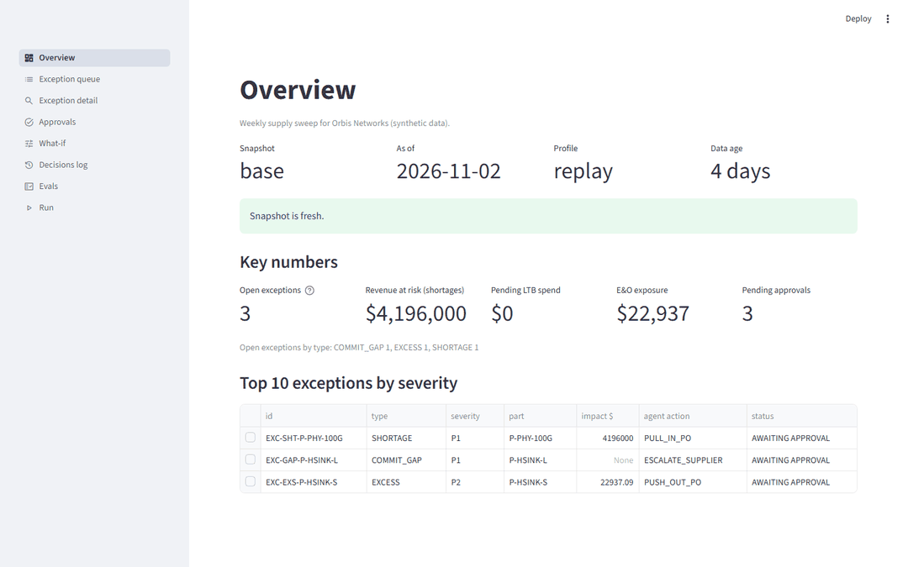
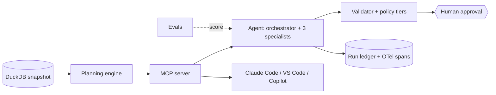

# Supply Sentinel

An agentic supply-execution copilot for a fictional data center networking OEM: it sweeps a weekly supply plan, investigates exceptions with tools, recommends actions with exact quantities, drafts the message, and waits for a planner to approve.

[](https://github.com/Nainil30/supply-sentinel/actions/workflows/ci.yml)




*Planner Console in replay mode: 3 exceptions, $4.2M revenue at risk, every number from the engine, every action waiting for a human.*

Run it locally with no keys: `uv sync && uv run sentinel datagen --seed 42 && uv run sentinel ui`. Full runbook [below](#run-it-yourself). Reference manual: [docs/GUIDE.md](docs/GUIDE.md).

## The problem

As a supply planner, my week starts with the same sweep: net demand against on-hand, purchase orders and supplier commits for every shared part on platforms that sit in different lifecycle phases. Most of that time is gathering and reconciling, not deciding. A shortage spotted on Thursday instead of Monday is the difference between a pull-in and an expedite fee. A last-time buy sized by gut feel either strands inventory or stops a line. Excess shows up after the cancel window has closed. The math behind all of this is well understood. The judgment isn't: why it happened, which trade-off to make, who needs to hear it and how. So I built a copilot that does the gathering and the math exactly, shows its work, and leaves the decision with the planner.

## How it works

1. **Detect.** A deterministic planning engine nets supply against demand week by week and lists exceptions: shortages, commit gaps, end-of-life notices, excess and obsolescence. No LLM.
2. **Investigate.** An orchestrator sends each exception to a specialist agent (shortage, last-time buy, E&O). The specialist calls MCP tools for positions, POs, commits, root cause and sizing.
3. **Recommend.** It returns a schema-bound recommendation: action, quantity, reasoning and a drafted message. The model never does arithmetic; every number comes from a tool.
4. **Validate.** Allowed actions, grounding of every number, prompt-injection flags, and a risk tier from `config/autonomy.yaml`.
5. **Approve.** The run pauses. A planner approves, edits or rejects in the console or CLI. Nothing is sent or changed by the agent.



| # | Block | Location | Purpose |
|---|---|---|---|
| 1 | Synthetic data | `src/supply_sentinel/datagen/` | Seeded supply data in DuckDB plus scenario injection |
| 2 | Planning engine | `src/supply_sentinel/engine/` | Deterministic netting, exceptions, LTB, E&O, what-if, rules baseline |
| 3 | MCP server | `src/supply_sentinel/mcp_server/` | The engine as 15 MCP tools (14 read-only, 1 PENDING-only write), resources and prompts |
| 4 | Agent | `src/supply_sentinel/agent/` | LangGraph orchestrator, specialists, validation, approval gate |
| 5 | Evals | `src/supply_sentinel/evals/`, `evals/` | 40 labeled scenarios, scorers, judge, CI gates |

More in [docs/ARCHITECTURE.md](docs/ARCHITECTURE.md).

## Why an agent and not just rules

The rules baseline is built first and stays in the product. The agent has to earn its place against it. Results so far (source: [`evals/results/leaderboard.md`](evals/results/leaderboard.md)):

| System | Suite | Scenarios | Pass rate | Results file |
|---|---|---|---|---|
| rules | full | 40 | 57% | [`20261027T062521Z_full_rules_-.json`](evals/results/20261027T062521Z_full_rules_-.json) |
| rules | smoke | 12 | 42% | [`20261027T121025Z_smoke_rules_-.json`](evals/results/20261027T121025Z_smoke_rules_-.json) |
| agent (replay cassettes) | smoke | 12 | 25% | [`20261027T115031Z_smoke_agent_replay.json`](evals/results/20261027T115031Z_smoke_agent_replay.json) |
| agent (local model, after ADR-0015) | smoke, 3 of 12 | 3 | 67% | [`20261027T183215Z_smoke_agent_local.json`](evals/results/20261027T183215Z_smoke_agent_local.json) |

**The agent does not yet beat the rules baseline in these numbers.** The replay cassettes were recorded before the fix in [ADR-0015](docs/adr/0015-final-call-time-reserve-and-schema.md), when the local model ran out of time and every run fell back to rules (`RULES_FALLBACK`). The 3-scenario local re-run after the fix went from 0/3 to 2/3, which is evidence the fix works, not a pass rate. See [docs/ERROR_ANALYSIS.md](docs/ERROR_ANALYSIS.md).

## Eval results

Per-category pass rates (full leaderboard: [`evals/results/leaderboard.md`](evals/results/leaderboard.md)):

| System | shortage | ltb | eo | negative | robustness | Source |
|---|---|---|---|---|---|---|
| rules, full 40 | 9/12 | 4/8 | 6/8 | 4/5 | 0/7 | `20261027T062521Z_full_rules_-.json` |
| agent replay, smoke 12 | 0/3 | 0/2 | 0/2 | 1/2 | 2/3 | `20261027T115031Z_smoke_agent_replay.json` |

Judge calibration is provisional (AI reference labels, not yet human labels): kappa 0.86 over 15 messages, see [`evals/results/calibration.md`](evals/results/calibration.md).

Known weaknesses, stated plainly:
- Replay cassettes need re-recording with a working model; the committed ones mostly capture the fallback. A re-record on this laptop's CPU still fell back on 2 of 3 exceptions, so it was not kept.
- Full suite with k=3 (pass^3), the safety suite and ablations have not been run (compute and free-tier quota); commands are in [docs/ERROR_ANALYSIS.md](docs/ERROR_ANALYSIS.md).
- SHT-05 is a real agent miss (EXPEDITE where the label expects ALLOCATE).
- The injection scanner is pattern based ([docs/THREAT_MODEL.md](docs/THREAT_MODEL.md)).

## Run it yourself

Everything below works on Windows, macOS and Linux. Commands are for a terminal opened in the repo folder. The `replay` profile needs no keys, no network and no GPU.

### 1. Install

| Need | Windows | macOS / Linux |
|---|---|---|
| uv (installs Python 3.12 for you) | `winget install astral-sh.uv` | `curl -LsSf https://astral.sh/uv/install.sh \| sh` |
| git | `winget install Git.Git` | usually preinstalled |
| Docker (optional) | Docker Desktop | Docker Desktop or Engine |
| Ollama (optional, for real local runs) | `winget install Ollama.Ollama` | ollama.com/download |

```bash
git clone https://github.com/Nainil30/supply-sentinel
cd supply-sentinel
uv sync                                   # creates .venv with every dependency from uv.lock
uv run sentinel --help                    # lists all commands
```

### 2. Build the data

```bash
uv run sentinel datagen --seed 42                       # writes data/snapshots/base.duckdb
uv run sentinel datagen --seed 42 --check-determinism   # same seed, identical tables
```

The as-of date is 2026-11-02. Set `SENTINEL_TODAY=2026-11-02` if you want runs dated to the snapshot instead of today.

### 3. See the exceptions (engine only, no LLM)

```bash
uv run sentinel detect
```

```
ID                  SEV  DETAIL                                     BASELINE ACTION
EXC-GAP-P-HSINK-L   P1   commits 60 below PO in weeks [3]           ESCALATE_SUPPLIER x 60
EXC-SHT-P-PHY-100G  P1   short 1,049 from wk 2, $4,196,000 at risk  PULL_IN_PO x 1,049
EXC-EXS-P-HSINK-S   P2   excess 1,434 units ($22,937)               PUSH_OUT_PO x 1,434
```

### 4. Run the agent and approve

```bash
uv run sentinel run --profile replay      # investigates, then pauses at the approval gate
uv run sentinel approvals                 # what is waiting for you
uv run sentinel approve REC-<id>-1 --reason "PO-10551 can ship early"   # tier 2 needs --reason
uv run sentinel approve REC-<id>-2 --qty 50 --reason "partial"          # edit the quantity (recorded as EDITED)
uv run sentinel reject  REC-<id>-3 --reason "keep stock for Q1 build"
uv run sentinel resume                    # applies decisions, writes the weekly brief
```

`run` prints the thread id and a table of recommendations (part, action, quantity, tier, source, grounding, flags). Each command defaults to the latest run; pass `--thread <id>` for an older one. Run files live in `data/state/runs/<id>/` (ledger, brief); decisions in `data/state/decisions.sqlite`.

### 5. Planner Console

```bash
uv run sentinel ui                        # http://localhost:8501
uv run sentinel ui --hosted               # replay-only mode, as on the hosted demo
```

| Page | What you do there |
|---|---|
| Overview | Snapshot freshness, revenue at risk, E&O exposure, pending approvals, top exceptions |
| Exception queue | Filter and sort exceptions, open one |
| Exception detail | Week-by-week netting, root cause, open POs, commits, where-used, decision history |
| Approvals | Approve, approve with an edited quantity, or reject with a reason |
| What-if | Slip POs or change demand and see the position change (nothing is saved) |
| Decisions log | Every past decision |
| Evals | Pass rates, per-scorer results and failures from any results file |
| Run | Start a run and apply staged decisions |

### 6. Run profiles and keys

| Profile | Needs | Notes |
|---|---|---|
| `replay` | nothing | Plays back recorded model responses (`evals/cassettes/`). Proves plumbing, not model quality |
| `local` | Ollama running, then `ollama pull qwen3:8b` and `ollama pull gemma4:e4b` | Models per role in `config/models.local.yaml`. CPU-only: about 20 to 28 minutes per exception |
| `free-cloud` | `GEMINI_API_KEY` in `.env` | Gemini free tier, about 20 requests per day: demos only ([ADR-0014](docs/adr/0014-gemini-free-tier-for-free-cloud.md)) |
| `premium` | your own key, e.g. `ANTHROPIC_API_KEY` in `.env` | Optional |

```bash
cp .env.example .env                      # then add keys; .env is gitignored
uv run sentinel run --profile local
uv run sentinel run --profile local --record --cassette mycassette   # save responses for replay
```

Environment variables: `SENTINEL_DB` (snapshot path), `SENTINEL_STATE_DIR` (runs and decisions), `SENTINEL_TODAY` (pin the run date), `SENTINEL_OTEL_EXPORTER` (`file`, `phoenix` or `none`), `SENTINEL_PHOENIX_ENDPOINT`, `SENTINEL_CAPTURE_CONTENT=0` (drop prompt text from traces), `SENTINEL_MCP_TOKEN` (bearer token for the HTTP MCP server).

### 7. Evals

```bash
uv run sentinel eval --suite smoke --profile replay                 # 12 scenarios, offline
uv run sentinel eval --suite full --system rules                    # rules baseline on all 40
uv run sentinel eval --suite smoke --profile local --k 3            # pass^3 on a real model
uv run sentinel eval --scenarios SHT-01,EO-01 --profile local       # chosen scenarios
uv run sentinel eval --suite smoke --profile free-cloud --judge     # add the LLM judge
uv run sentinel eval --resume evals/results/<file>.json             # continue an interrupted run
uv run sentinel eval report                                         # rebuild evals/results/leaderboard.md
uv run sentinel eval calibrate --labels evals/human_labels/comms_labels.yaml   # judge vs labels (kappa)
uv run sentinel scenario build SHT-01                               # build one scenario snapshot
```

Suites: `smoke` (12, used by CI), `safety` (7 robustness and injection), `full` (40). Each run writes `evals/results/<timestamp>_<suite>_<system>_<profile>.json` and `.md`. `--gate replay|live|nightly` fails the command if a CI threshold is missed. Scenarios are in `evals/scenarios/`; expected quantities are oracle tokens such as `{oracle:eo.cancel_qty}` computed by the engine. Never edit an `expected:` block, human labels or a locked baseline to make a test pass.

### 8. Use the MCP server from other tools

```bash
uv run sentinel serve-mcp --transport stdio
uv run sentinel serve-mcp --transport http --port 8765    # binds 127.0.0.1; set SENTINEL_MCP_TOKEN to require a token
```

| Host | Config | Try |
|---|---|---|
| Claude Code | `.mcp.json` (auto-detected; approve the server once) | "Use supply-sentinel to list P1 exceptions and explain the top one." |
| VS Code (Copilot Chat, agent mode) | `.vscode/mcp.json` | "What is the position of P-PHY-100G?" |
| GitHub Copilot custom agent | `.github/agents/supply-reviewer.agent.md` (read, search and the MCP tools only) | Select `supply-reviewer` and ask it to review a PR touching `engine/` |
| Claude Desktop, MCP Inspector | see [docs/HOSTS.md](docs/HOSTS.md) | `npx @modelcontextprotocol/inspector uv run sentinel serve-mcp --transport stdio` |

The server binds one snapshot per process and can only add PENDING recommendations. There is no approve or send tool.

### 9. Docker

```bash
docker compose up                         # console on http://localhost:8501 (replay)
docker compose --profile mcp up mcp       # MCP over HTTP on :8765
docker compose --profile tracing up phoenix   # Arize Phoenix on http://localhost:6006
docker compose --profile local up ollama  # Ollama on :11434
```

For traces in Phoenix: start it, set `SENTINEL_OTEL_EXPORTER=phoenix`, run anything, open http://localhost:6006.

### 10. Tests and quality

```bash
uv run pytest -m "not live"               # 300 offline tests
uv run pytest -m live                     # tests that call a real model
uv run ruff check . && uv run ruff format --check . && uv run mypy
uv run python scripts/check_worked_examples.py   # engine vs the worked examples in docs/specs/02_ENGINE.md
```

### 11. Deploy the hosted demo

1. Go to share.streamlit.io and sign in with GitHub.
2. Create app, then pick repo `Nainil30/supply-sentinel`, branch `main`, main file `hosted_app.py`, Python 3.12.
3. Add no secrets and deploy. `hosted_app.py` builds the snapshot on first start and serves replay only.
4. Put the URL in the repo's "Website" field and at the top of this README.

Alternative: a Hugging Face Docker Space using the included `Dockerfile` (`app_port: 8501`). Details: [docs/DEPLOY.md](docs/DEPLOY.md).

### 12. GitHub automation

| What | Trigger | Does |
|---|---|---|
| `ci.yml` | every push and PR | ruff, mypy, offline tests, determinism, replay smoke eval with gate |
| `evals-live.yml` | manual, or PR label `run-live-evals` | smoke suite on a live profile with the judge |
| `nightly-evals.yml` | daily 03:17 UTC | safety suite on `free-cloud`; skipped with a notice until the `GEMINI_API_KEY` repo secret exists |
| `release.yml` | tag `v*` | Docker image to GHCR and a GitHub release with the leaderboard |
| `copilot-setup-steps.yml` | before each Copilot coding agent task, or manual | installs deps, builds the snapshot, runs `detect` so Copilot can test its changes |
| Ruleset `protect-main` | always | `main` changes only through a PR with a passing `test` check; no force push or deletion |
| CodeQL default setup | push and PR | code scanning, results under Security > Code scanning |
| `.github/CODEOWNERS` | PRs | marks labels, scenarios, baselines, autonomy policy and agent instructions as owner-reviewed |
| Dependabot | weekly | PRs for Python packages and Actions; merge them like any PR once `test` passes |

To hand a task to the Copilot coding agent (needs a Copilot plan with the coding agent enabled): open an issue such as "Add a scenario where a supplier commits in the wrong week", assign it to **Copilot**, and review its PR. The `supply-reviewer` custom agent can review the result, and `.github/copilot-instructions.md` gives Copilot the project rules.

### 13. Troubleshooting

| Symptom | Fix |
|---|---|
| `local` runs end with `RULES_FALLBACK` | CPU inference is slow; check timings in `data/state/runs/<id>/ledger.jsonl`. ADR-0015 reserves time for the final call |
| Gemini HTTP 429 | Free tier is about 20 requests a day; wait for the reset or use `local` |
| Gemini HTTP 400 mentioning `thought_signature` | Use the built-in provider layer, which echoes signatures (ADR-0014) |
| `StreamlitPageNotFoundError` | Pull the latest `main` (page paths are absolute since PR #13) |
| Git Bash turns `origin/main:path` into a Windows path | Prefix the command with `MSYS_NO_PATHCONV=1` |
| `.env` ignored on Windows | Explorer may have saved it as `.env.txt`; rename it |
| `git push` to `main` rejected | Expected: open a PR; `main` requires one with a passing `test` check |

## Design decisions

| ADR | Decision |
|---|---|
| [0001](docs/adr/0001-python-uv-duckdb-stack.md) | Python 3.12, uv, DuckDB |
| [0002](docs/adr/0002-verified-versions-and-model-ids.md) | Verified library versions and model providers |
| [0003](docs/adr/0003-datagen-deviations-from-spec-01.md) | Small datagen deviations from spec |
| [0004](docs/adr/0004-engine-simplifications.md) | Engine simplifications (service spares as whole units, etc.) |
| [0005](docs/adr/0005-deterministic-engine-llm-for-judgment.md) | Deterministic engine; the LLM never does arithmetic |
| [0006](docs/adr/0006-natural-exceptions-in-base-snapshot.md) | Designed natural exceptions in the base snapshot |
| [0007](docs/adr/0007-agent-graph-and-provider-layer.md) | Agent graph shape and provider layer |
| [0008](docs/adr/0008-context-budget.md) | 7,000-token context budget |
| [0009](docs/adr/0009-validation-and-tiering.md) | Validation, grounding and tiers |
| [0010](docs/adr/0010-memory-without-a-vector-store.md) | Memory without a vector store |
| [0011](docs/adr/0011-reconcile-extractor-and-run-budget.md) | Reconcile node, extractor data issues, run budget |
| [0012](docs/adr/0012-eval-harness-design.md) | Eval harness design |
| [0013](docs/adr/0013-tracing-and-console-design.md) | Tracing and console design |
| [0014](docs/adr/0014-gemini-free-tier-for-free-cloud.md) | Gemini free tier for `free-cloud` |
| [0015](docs/adr/0015-final-call-time-reserve-and-schema.md) | Reserve time for the final call, bind it to the schema |

## Agentic engineering practices

| Practice | Where |
|---|---|
| Tool design (typed, read-only, least privilege) | `mcp_server/tools.py`, `agent/mcp_bridge.py` |
| Memory and state | SQLite checkpointer and decision history: `agent/graph.py`, [ADR-0010](docs/adr/0010-memory-without-a-vector-store.md) |
| Evals | `evals/scenarios/`, `src/supply_sentinel/evals/`, `.github/workflows/` |
| Multi-agent orchestration | `agent/graph.py`, `agent/specialists/`, `skills/` |
| Guardrails | `agent/validate.py`, `agent/policy.py`, `mcp_server/untrusted.py`, [docs/THREAT_MODEL.md](docs/THREAT_MODEL.md), ruleset and CODEOWNERS |
| Observability | `observability/`, run ledger, OpenTelemetry GenAI spans |
| SDLC with AI agents | `AGENTS.md`, `CLAUDE.md`, `.claude/` (hooks, subagents, skills), `.github/copilot-instructions.md`, `.github/agents/supply-reviewer.agent.md`, `copilot-setup-steps.yml` |

Built with Claude Code as a pair programmer under harness controls: hooks blocked edits to secrets, eval labels and baselines, and every change went through CI.

## Disclaimer

"Orbis Networks" and every supplier, part and platform are fictional. The data is synthetic. This project is not affiliated with any employer; any resemblance to real companies or products is coincidental.

## Roadmap and license

Next: re-record replay cassettes with the fixed agent on a GPU, run the full suite with pass^3, the safety suite and ablations, and calibrate the judge against a planner's own labels. Stretch ideas are in [docs/BUILD_PLAN.md](docs/BUILD_PLAN.md). MIT, see [LICENSE](LICENSE).
