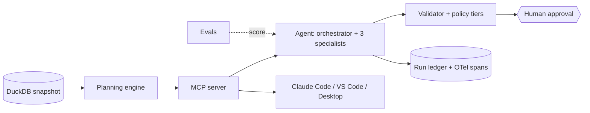

# Supply Sentinel

An agentic supply-execution copilot for a fictional data center networking OEM: it sweeps a weekly supply plan, investigates exceptions with tools, recommends actions with exact quantities, drafts the message, and waits for a planner to approve.

[](https://github.com/Nainil30/supply-sentinel/actions/workflows/ci.yml)


Hosted demo: _link added after deploy, see [docs/DEPLOY.md](docs/DEPLOY.md)._ Demo GIF: _to be recorded, see [docs/DEMO_SCRIPT.md](docs/DEMO_SCRIPT.md)._

## The problem

<!-- DRAFT (first person, from docs/PROJECT_BRIEF.md). Owner: rewrite in your own words. -->
Every week I own several switch platforms in different lifecycle phases, and most of my time goes into gathering and reconciling: netting demand against inventory, purchase orders and supplier commits for dozens of shared parts, catching shortages early enough to expedite or pull in, sizing a last-time buy when a supplier announces end of life, and spotting excess and obsolete exposure while orders can still be moved. The math is well understood. The judgment (root cause, trade-offs, who to tell and how) is where a planner earns their pay, so I built a tool that does the gathering and the math exactly, and leaves the decision to me.

## Architecture



| # | Block | Location | Purpose |
|---|---|---|---|
| 1 | Synthetic data | `src/supply_sentinel/datagen/` | Seeded supply data in DuckDB plus scenario injection |
| 2 | Planning engine | `src/supply_sentinel/engine/` | Deterministic netting, exceptions, LTB, E&O, what-if, rules baseline |
| 3 | MCP server | `src/supply_sentinel/mcp_server/` | The engine as MCP tools, resources and prompts |
| 4 | Agent | `src/supply_sentinel/agent/` | LangGraph orchestrator, specialists, validation, approval gate |
| 5 | Evals | `src/supply_sentinel/evals/`, `evals/` | 40 labeled scenarios, scorers, judge, CI gates |

More in [docs/ARCHITECTURE.md](docs/ARCHITECTURE.md).

## Why an agent and not just rules

The rules baseline is built first and stays in the product. The agent has to earn its place against it. Results so far (source: [`evals/results/leaderboard.md`](evals/results/leaderboard.md)):

| System | Suite | Scenarios | Pass rate | Results file |
|---|---|---|---|---|
| rules | full | 40 | 57% | [`20261027T062521Z_full_rules_-.json`](evals/results/20261027T062521Z_full_rules_-.json) |
| rules | smoke | 12 | 42% | [`20261027T121025Z_smoke_rules_-.json`](evals/results/20261027T121025Z_smoke_rules_-.json) |
| agent (replay cassettes) | smoke | 12 | 25% | [`20261027T115031Z_smoke_agent_replay.json`](evals/results/20261027T115031Z_smoke_agent_replay.json) |
| agent (local model, after ADR-0015) | smoke, 3 of 12 | 3 | 67% | [`20261027T183215Z_smoke_agent_local.json`](evals/results/20261027T183215Z_smoke_agent_local.json) |

**The agent does not yet beat the rules baseline in these numbers.** The replay cassettes were recorded before the fix in [ADR-0015](docs/adr/0015-final-call-time-reserve-and-schema.md), when the local model ran out of time and every run fell back to rules (`RULES_FALLBACK`). The 3-scenario local re-run after the fix went from 0/3 to 2/3, which is evidence the fix works, not a pass rate. See [docs/ERROR_ANALYSIS.md](docs/ERROR_ANALYSIS.md).

## Eval results

Per-category pass rates (full leaderboard: [`evals/results/leaderboard.md`](evals/results/leaderboard.md)):

| System | shortage | ltb | eo | negative | robustness | Source |
|---|---|---|---|---|---|---|
| rules, full 40 | 9/12 | 4/8 | 6/8 | 4/5 | 0/7 | `20261027T062521Z_full_rules_-.json` |
| agent replay, smoke 12 | 0/3 | 0/2 | 0/2 | 1/2 | 2/3 | `20261027T115031Z_smoke_agent_replay.json` |

Judge calibration is provisional (AI reference labels, owner relabel pending): kappa 0.86 over 15 messages, see [`evals/results/calibration.md`](evals/results/calibration.md).

Known weaknesses, stated plainly:
- Replay cassettes need re-recording with a working model; the committed ones mostly capture the fallback.
- Full suite with k=3 (pass^3), the safety suite and ablations have not been run (compute and free-tier quota); commands are in [docs/ERROR_ANALYSIS.md](docs/ERROR_ANALYSIS.md).
- SHT-05 is a real agent miss (EXPEDITE where the label expects ALLOCATE).
- The injection scanner is pattern based ([docs/THREAT_MODEL.md](docs/THREAT_MODEL.md)).

## Quickstart (replay, no keys)

```bash
git clone https://github.com/Nainil30/supply-sentinel && cd supply-sentinel
docker compose up            # console on http://localhost:8501
# or without Docker:
uv sync && uv run sentinel datagen --seed 42 && uv run sentinel ui
```

Other commands: `uv run sentinel detect` (deterministic exceptions, no LLM), `uv run sentinel eval --suite smoke --profile replay`, `uv run pytest -m "not live"`.

## Run modes

| Profile | What it needs | Command |
|---|---|---|
| `replay` | nothing (recorded responses) | `uv run sentinel run --profile replay` |
| `local` | Ollama running locally | `uv run sentinel run --profile local` |
| `free-cloud` | Gemini free-tier key in `.env` ([ADR-0014](docs/adr/0014-gemini-free-tier-for-free-cloud.md)) | `uv run sentinel run --profile free-cloud` |
| `premium` | your own provider key (optional) | `uv run sentinel run --profile premium` |

## Use the MCP server from your own tools

`.mcp.json` (Claude Code) and `.vscode/mcp.json` (VS Code) are included. Over HTTP: `docker compose --profile mcp up mcp`, port 8765. Step by step: [docs/HOSTS.md](docs/HOSTS.md).

## Design decisions

| ADR | Decision |
|---|---|
| [0001](docs/adr/0001-python-uv-duckdb-stack.md) | Python 3.12, uv, DuckDB |
| [0002](docs/adr/0002-verified-versions-and-model-ids.md) | Verified library versions and model providers |
| [0003](docs/adr/0003-datagen-deviations-from-spec-01.md) | Small datagen deviations from spec |
| [0004](docs/adr/0004-engine-simplifications.md) | Engine simplifications (service spares as whole units, etc.) |
| [0005](docs/adr/0005-deterministic-engine-llm-for-judgment.md) | Deterministic engine; the LLM never does arithmetic |
| [0006](docs/adr/0006-natural-exceptions-in-base-snapshot.md) | Designed natural exceptions in the base snapshot |
| [0007](docs/adr/0007-agent-graph-and-provider-layer.md) | Agent graph shape and provider layer |
| [0008](docs/adr/0008-context-budget.md) | 7,000-token context budget |
| [0009](docs/adr/0009-validation-and-tiering.md) | Validation, grounding and tiers |
| [0010](docs/adr/0010-memory-without-a-vector-store.md) | Memory without a vector store |
| [0011](docs/adr/0011-reconcile-extractor-and-run-budget.md) | Reconcile node, extractor data issues, run budget |
| [0012](docs/adr/0012-eval-harness-design.md) | Eval harness design |
| [0013](docs/adr/0013-tracing-and-console-design.md) | Tracing and console design |
| [0014](docs/adr/0014-gemini-free-tier-for-free-cloud.md) | Gemini free tier for `free-cloud` |
| [0015](docs/adr/0015-final-call-time-reserve-and-schema.md) | Reserve time for the final call, bind it to the schema |

## Agentic engineering practices

| Practice | Where |
|---|---|
| Tool design (typed, read-only, least privilege) | `mcp_server/tools.py`, `agent/mcp_bridge.py` |
| Memory and state | SQLite checkpointer and decision history: `agent/graph.py`, [ADR-0010](docs/adr/0010-memory-without-a-vector-store.md) |
| Evals | `evals/scenarios/`, `src/supply_sentinel/evals/`, `.github/workflows/` |
| Multi-agent orchestration | `agent/graph.py`, `agent/specialists/`, `skills/` |
| Guardrails | `agent/validate.py`, `agent/policy.py`, `mcp_server/untrusted.py`, [docs/THREAT_MODEL.md](docs/THREAT_MODEL.md) |
| Observability | `observability/`, run ledger, OpenTelemetry GenAI spans |
| SDLC with AI | `AGENTS.md`, `CLAUDE.md`, `.claude/`, `.github/agents/supply-reviewer.agent.md` |

## Disclaimer

"Orbis Networks" and every supplier, part and platform are fictional. The data is synthetic. This project is not affiliated with any employer; any resemblance to real companies or products is coincidental.

## Roadmap and license

Next: re-record replay cassettes with a working model, then run the full suite with pass^3, the safety suite and ablations; stretch ideas are in [docs/BUILD_PLAN.md](docs/BUILD_PLAN.md). MIT, see [LICENSE](LICENSE).
