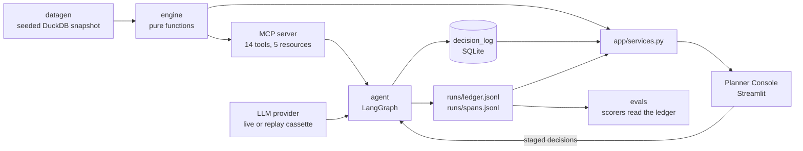
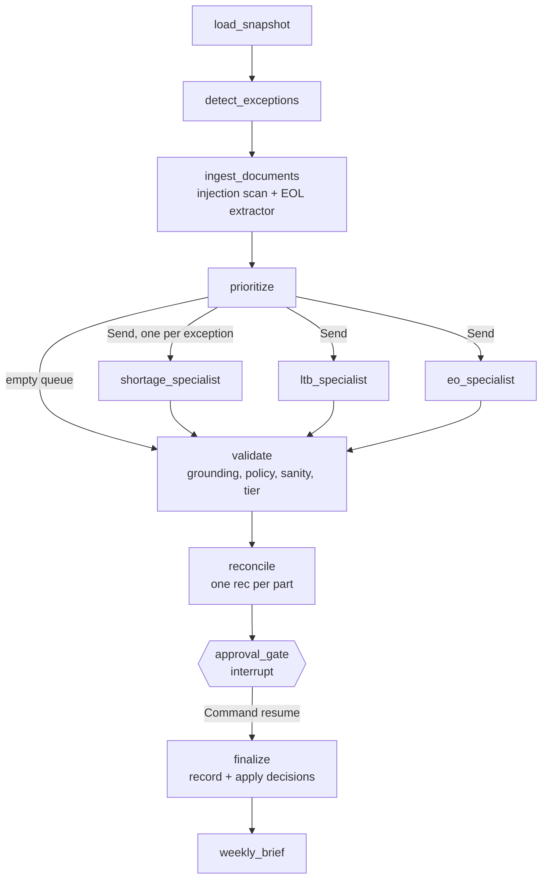
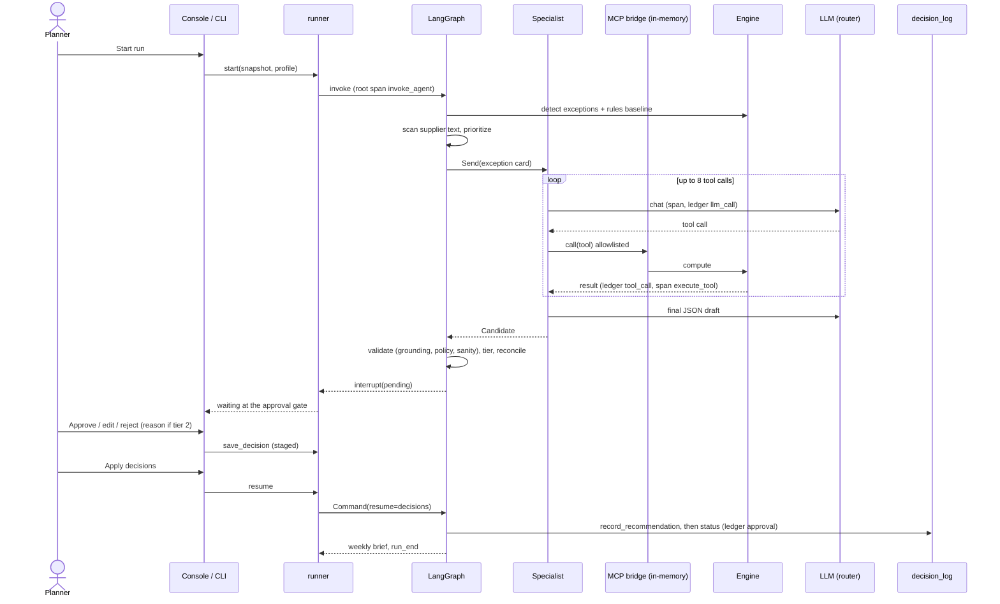

# Architecture

Supply Sentinel is three systems that share one rule: the engine computes, the agent reasons, a human approves.

## The three harnesses

| Harness | Controls | Where |
|---|---|---|
| Runtime | Tool allowlists per skill, run and specialist budgets, 7k-token context budget, validation with one repair, autonomy tiers, approval gate, SQLite checkpoints, ledger and traces | `src/supply_sentinel/agent/`, `llm/`, `observability/`, `config/` |
| Eval | 40 labeled scenarios, oracle quantities, scorers, independent grounding re-check, LLM judge, CI gates | `src/supply_sentinel/evals/`, `evals/` |
| Development | AGENTS.md, CLAUDE.md, hooks, subagents, skills, protected paths, CI | `.claude/`, `.github/`, root files |

## Data flow

## The agent graph

Specialists run in parallel up to `max_parallel_specialists`. State holds plain data only, so a run that paused in one process resumes in another.

## One exception, detection to approval

## Observability

- `runs/<run_id>/ledger.jsonl` is the system of record: `run_start`, `llm_call`, `tool_call` (full output, latency), `validation`, `approval_gate`, `decision`, `approval`, `run_end`. The grounding scorer reads it.
- `runs/<run_id>/spans.jsonl` holds OpenTelemetry spans: `invoke_agent`, `execute_tool`, `chat` (GenAI conventions) and one span per LangGraph node (OpenInference).
- `otel.exporter: phoenix` also sends the spans to Phoenix: `docker run -p 6006:6006 arizephoenix/phoenix`, then `SENTINEL_OTEL_EXPORTER=phoenix sentinel run`.
- `SENTINEL_CAPTURE_CONTENT=0` keeps prompts and tool payloads off spans. See ADR-0013.

## Planner Console

`sentinel ui` starts Streamlit. Pages: Overview, Exception queue, Exception detail, Approvals, What-if, Decisions log, Evals, Run. Pages call `app/services.py` only; it uses the engine tools, the runner and the decision store. Untrusted supplier text is always rendered with `st.text` inside a labeled box.
